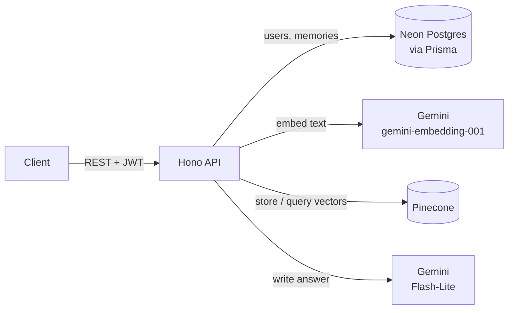

# Memory Assistant API

A backend for a personal AI assistant that answers questions using **your own notes**.
Save memories (notes with a title and tags), then ask questions in plain English. The API
finds the most relevant memories by meaning and has an LLM write an answer grounded in them.
This pattern is called retrieval-augmented generation (RAG).

```http
POST /ai/search
{ "query": "Where did I go scuba diving?" }
```
```json
{
  "answer": "You went scuba diving at Grande Island [1].",
  "references": [
    { "id": 6, "title": "Trip to Goa", "score": 0.644, "citation": 1, "cited": true, ... }
  ]
}
```

## Features

- **Semantic search** over your memories, matching by meaning, not just keywords
- **Grounded answers with citations**: the answer cites its sources as `[1]`, `[2]`, and each
  returned memory says whether it was cited and how similar it is to the question
- **Relevance filtering**: weak matches are dropped, and when nothing relevant is found the
  LLM isn't called at all
- **Streaming answers** over Server-Sent Events, with sources sent before the answer starts
- **Memory management**: create, edit, delete, paginate, filter by tags, date range or text
- **JWT authentication** with bcrypt password hashing; every query is scoped to the signed-in user
- **Input validation** with size limits on every request (Zod)
- **Free to run**: Neon Postgres, Pinecone and the Gemini API all have free tiers

## How it works



**Saving a memory:** the memory is stored in Postgres, then embedded by Gemini
(a 1024-number vector) and stored in Pinecone with the owner's user ID.

**Asking a question:**
1. The question is embedded with Gemini, using query mode.
2. Pinecone returns the closest memory vectors, filtered to the current user. Matches below
   a similarity cutoff (`MIN_RELEVANCE_SCORE`, default 0.55) are dropped.
3. The matching memories are loaded from Postgres, so answers always use the latest
   version of each note, with real dates.
4. Gemini writes an answer using only those numbered memories, citing them as `[n]`.

## Tech stack

| Area | Tools |
|---|---|
| Runtime and language | Node.js 24, TypeScript |
| Web framework | [Hono](https://hono.dev) |
| Database | PostgreSQL on [Neon](https://neon.tech), [Prisma](https://www.prisma.io) ORM |
| Vector search | [Pinecone](https://www.pinecone.io) (serverless) |
| AI models | Google Gemini: `gemini-embedding-001`, `gemini-flash-lite-latest` |
| Validation and auth | Zod, JWT (HS256), bcryptjs |

## Getting started

### Prerequisites

- Node.js 20 or later
- Free accounts on [Neon](https://neon.tech), [Pinecone](https://www.pinecone.io) and
  [Google AI Studio](https://aistudio.google.com) (Gemini API key)

### 1. Install

```bash
git clone https://github.com/A-k-S-H-a-Y-K/projectz2.git
cd projectz2
npm install
```

### 2. Configure environment variables

```bash
cp .env.example .env
```

| Variable | Where to get it |
|---|---|
| `DATABASE_URL` | Neon dashboard → Connect → **pooled** connection string |
| `DIRECT_URL` | Neon dashboard → Connect → direct (non-pooled) connection string |
| `JWT_SECRET` | Any long random string, e.g. `node -e "console.log(require('crypto').randomBytes(48).toString('hex'))"` |
| `PINECONE_API_KEY` | Pinecone console → API Keys |
| `GEMINI_API_KEY` | Google AI Studio → Get API key |

`PINECONE_INDEX_NAME`, `JWT_EXPIRES_IN`, `GEMINI_CHAT_MODEL`, `MIN_RELEVANCE_SCORE`, `PORT`
and `CORS_ORIGIN` have working defaults in `.env.example`.

### 3. Create the database tables and the vector index

```bash
npx prisma migrate deploy
npm run pinecone:setup
```

### 4. Run

```bash
npm run dev
```

The API runs at `http://localhost:3001`. Check it with `GET /health`.

## API

All `/memories` and `/ai` routes need an `Authorization: Bearer <token>` header,
using the token returned by sign-up or login.

| Method | Route | Description |
|---|---|---|
| `GET` | `/health` | Health check |
| `POST` | `/auth/signup` | Create an account → user + token |
| `POST` | `/auth/login` | Log in → user + token |
| `GET` | `/auth/session` | Current user |
| `POST` | `/memories` | Create a memory (`title?`, `content`, `tags`) |
| `GET` | `/memories` | List memories. Query: `page`, `limit`, `search`, `tags`, `startDate`, `endDate` |
| `GET` | `/memories/:id` | Get one memory |
| `PUT` | `/memories/:id` | Update a memory |
| `DELETE` | `/memories/:id` | Delete a memory |
| `POST` | `/ai/search` | Ask a question → `answer` + `references` |
| `POST` | `/ai/search/stream` | Same, streamed as Server-Sent Events (see below) |

### Streaming

`/ai/search/stream` takes the same body as `/ai/search` and sends these events:

| Event | Data |
|---|---|
| `references` | The matching memories, sent before the answer starts |
| `token` | `{ "text": "..." }`, one piece of the answer |
| `done` | `{ "cited": [1] }`, the citation numbers used in the answer |
| `error` | `{ "error": "..." }`, sent instead of `done` if generation fails |

To watch a streamed answer in the terminal, start the server and run
`npm run stream-demo -- "Where did I go scuba diving?"`.

[`requests.http`](requests.http) has a ready-made example of every request. Open it in VS Code
with the [REST Client](https://marketplace.visualstudio.com/items?itemName=humao.rest-client)
extension and click **Send Request**.

## Project structure

```
src/
├── index.ts            # App setup, middleware, routes
├── routes/             # auth, memories, ai
├── services/ai.ts      # Embeddings, vector search, answer generation
├── middleware/auth.ts  # JWT verification
├── lib/                # Prisma client, auth helpers, timeout helper
├── validations/        # Zod request schemas
└── types/
prisma/                 # Schema and migrations
scripts/                # Pinecone index setup, streaming demo
```

## Scripts

| Command | What it does |
|---|---|
| `npm run dev` | Start the dev server with auto-reload |
| `npm run build` | Compile TypeScript to `dist/` |
| `npm start` | Run the compiled server |
| `npm run pinecone:setup` | Create the Pinecone index |
| `npm run stream-demo -- "<question>"` | Ask a question and print the streamed answer |
| `npm run prisma:studio` | Browse the database in a web UI |

## Roadmap

- [x] Source citations with relevance filtering
- [x] Streaming answers
- [ ] Hybrid search (keyword + semantic)
- [ ] Prompt-injection protection
- [ ] Retrieval and answer-quality evaluation
- [ ] Automated tests and CI
- [ ] Web frontend and deployment
